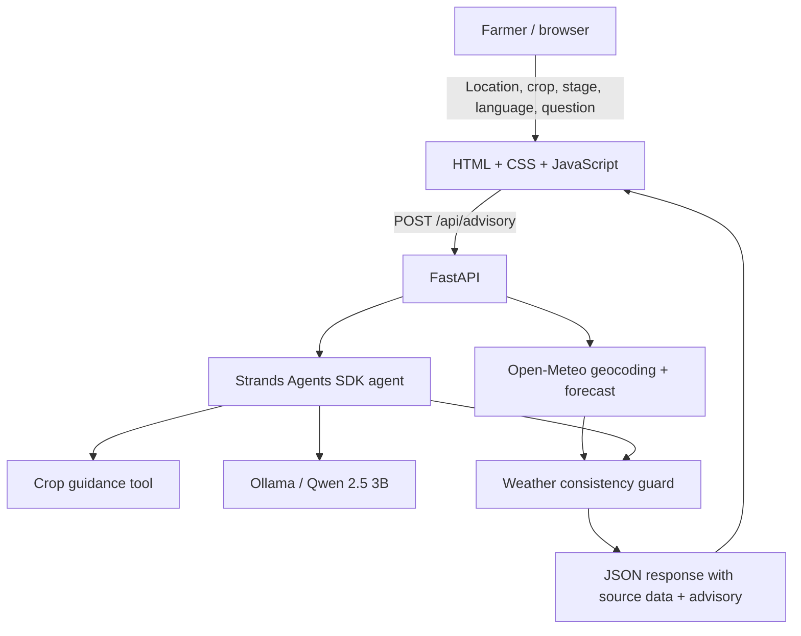

# KrishiMitra AI

**A climate-resilience decision-support prototype for smallholder farmers, built with the Strands Agents SDK.**

KrishiMitra combines a live seven-day weather forecast with crop-stage context and produces cautious English-language guidance. It is designed to make weather information easier to interpret, not to replace local agricultural extension services.

## Working prototype: what is implemented

- Live place-name geocoding and seven-day weather retrieval through Open-Meteo (no API key required).
- A FastAPI backend that validates inputs, fetches the weather snapshot, runs a Strands Agents SDK agent, and returns source metadata with the advisory.
- Local inference through Ollama; the default model is `qwen2.5:3b`.
- A Strands tool that supplies curated crop context for ragi, paddy/rice, maize, and groundnut. Other crop names receive a safe generic fallback rather than invented crop-specific instructions.
- English response selection. Kannada is intentionally disabled in this submission build because local-model output did not pass a basic quality check; native-speaker validation is required before enabling it.
- A browser interface that submits real API requests, displays the verified current-weather snapshot, renders the model response, and shows each of the seven forecast days.
- A narrow phrase-based guard that withholds explicit no-rain/dry-forecast claims when the verified seven-day rainfall total is positive. It is not general semantic fact verification.
- A dependency-aware health endpoint that checks whether Ollama is reachable and the configured model is installed.
- Automated tests for the API success path, upstream weather failure, model-output conflict handling, input validation, healthy/degraded model status, and frontend asset delivery.

The repository contains a real frontend and backend. `static/` means the browser assets (HTML, CSS, JavaScript) are served as files by FastAPI; it does **not** mean the application is a static website. The JavaScript calls the live `/api/advisory` endpoint and renders the returned weather and agent response.

## Architecture



Weather is retrieved once by the backend and returned as source-backed data with a retrieval timestamp. The agent receives that snapshot as context and invokes the crop-guidance tool. The UI renders the weather facts separately from generated interpretation so the model is not treated as the source of forecast truth.

See [`docs/ARCHITECTURE.md`](docs/ARCHITECTURE.md) for request flow, API schema, trust boundaries, and limitations.

## Run locally (Fedora, Ubuntu, macOS, or Linux)

### Prerequisites

- Python 3.11–3.13 (tested in this workspace with Python 3.13.14).
- [uv](https://docs.astral.sh/uv/) or Python `venv` + `pip`.
- [Ollama](https://ollama.com/) with enough RAM/VRAM for the selected model.
- Internet access for Open-Meteo geocoding and forecasts.

### 1. Clone and install

```bash
git clone https://github.com/PSP-YN/KrishiMitraAI.git
cd KrishiMitraAI
uv venv --python 3.13
uv pip install -r requirements.txt
```

If you use standard `venv`/`pip` instead:

```bash
python3.13 -m venv .venv
source .venv/bin/activate
python -m pip install --upgrade pip
python -m pip install -r requirements.txt
```

### 2. Start the local model

```bash
ollama pull qwen2.5:3b
ollama serve
```

Keep Ollama running in a separate terminal. If Ollama is already running as a service, do not start a second instance.

### 3. Configure and start the API

Defaults are shown in `.env.example`. The app reads environment variables directly; copy values into your shell as needed:

```bash
export OLLAMA_HOST=http://127.0.0.1:11434
export OLLAMA_MODEL=qwen2.5:3b
export PORT=8000
uvicorn main:app --host 127.0.0.1 --port "$PORT"
```

Open <http://127.0.0.1:8000>. The API documentation is available at <http://127.0.0.1:8000/docs>.

### 4. Verify dependencies and run tests

```bash
curl -sS http://127.0.0.1:8000/api/health
python -m unittest discover -s tests -v
python -m py_compile main.py
```

`/api/health` returns `status: ok` only when Ollama is reachable and the configured model is installed. A `degraded` status means the model dependency is unavailable; the endpoint does not claim the agent is ready.

## API

### `GET /api/health`

Returns Strands/Ollama configuration and real Ollama/model availability.

### `POST /api/advisory`

Request JSON:

```json
{
  "location": "Mysuru, Karnataka",
  "crop": "Ragi",
  "growth_stage": "Vegetative",
  "language": "English",
  "question": "What should I monitor this week?"
}
```

`language` must be `English` in this submission build. The response contains `advisory`, `agent_status`, `weather_summary`, the original `weather` snapshot, `generated_at`, `model`, `agent_framework`, and `weather_source`.

## Repository layout

```text
KrishiMitraAI/
├── main.py                 # FastAPI routes, Open-Meteo retrieval, Strands agent
├── static/
│   ├── index.html          # Browser page structure
│   ├── styles.css          # Responsive interface styling
│   └── app.js              # Live API integration and result rendering
├── tests/
│   ├── test_api.py         # API, validation, health, and asset tests
│   └── test_weather_guard.py
├── docs/
│   ├── ARCHITECTURE.md     # Request flow, trust boundaries, limitations
│   ├── BUILDER_CENTER_ARTICLE.md
│   ├── DEMO_SCRIPT.md
│   └── PITCH.md
├── requirements.txt
├── .env.example
└── LICENSE
```

## Social impact and validation

The intended beneficiaries are smallholder farmers and agricultural learners, who need understandable climate information. Kannada localization is a planned validation milestone, not a currently supported output. The current build is a prototype and has **not** been field-tested with farmers or validated by agricultural specialists. No crop-loss reduction, yield improvement, or farmer-impact metrics are claimed.

A supervised validation phase should measure forecast retrieval success, source/timestamp coverage, agent/tool failure rate, response latency, farmer comprehension, and usefulness with local farmers and extension personnel.

## Safety and limitations

- KrishiMitra is not an official weather alert, agricultural extension service, or substitute for KVK/ICAR advice.
- Forecasts are probabilistic and can change; verify current conditions locally.
- Crop guidance is a small curated starter knowledge base, not a validated agronomic knowledge system.
- The phrase-based weather guard catches only a limited set of explicit contradictions; it does not prove all generated statements are correct.
- Do not use the prototype to make pesticide/fertilizer dosing, yield, or irreversible sowing/irrigation decisions.
- Kannada output was tested with the local model but did not meet a quality bar; it is disabled until native-speaker review and a more reliable translation/generation path are available.
- The current local Ollama setup is a prototype deployment, not a public multi-user production service. No load or security certification is claimed.

## Hackathon

Built for **Strands SDK: Workshop to Ship** (AWS Builder Center), Climate Resilience focus area.

- Agent framework: Strands Agents SDK
- Inference: Ollama, Qwen 2.5 3B (local)
- Weather data: Open-Meteo
- API: FastAPI
- Frontend: HTML, CSS, JavaScript

## License

MIT. See [`LICENSE`](LICENSE).
